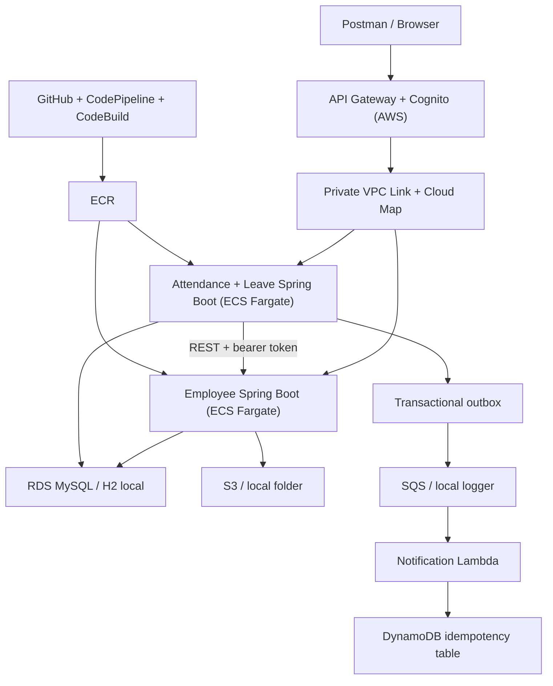

# Workforce Management System | Java Microservices + AWS Portfolio

**A code-first learning repository** for Java 21, Spring Boot 3.5, H2, REST, Spring Security, distributed systems, Amazon ECS/Fargate, API Gateway, Cognito, RDS, S3, SQS, Lambda, CloudWatch, Terraform and AWS CodePipeline/CodeBuild.

> **Status:** Reference implementation for study and portfolio development, not a certified production HR platform. The AWS infrastructure requires your own account, credentials, actual image builds, and verification. Do not store real employee data in this sample. **Local execution requires no Docker, AWS account or MySQL installation.**

## Local run: four commands, two terminals

**Prerequisites:** JDK 21, Apache Maven 3.9+, Git. No Docker, MySQL or AWS needed.

```powershell
# From the repository root - terminal 1 (Windows PowerShell)
mvn -DskipTests install
mvn -pl employee-service spring-boot:run "-Dspring-boot.run.profiles=local"

# Terminal 2 (in the same repository)
mvn -pl leave-service spring-boot:run "-Dspring-boot.run.profiles=local"
```

```bash
# Bash / macOS / Linux alternatives
mvn -DskipTests install
mvn -pl employee-service spring-boot:run -Dspring-boot.run.profiles=local
# Second terminal:
mvn -pl leave-service spring-boot:run -Dspring-boot.run.profiles=local
```

Check `http://localhost:8081/actuator/health` and `http://localhost:8082/actuator/health`.

Try the first request:

```bash
curl -H "X-Demo-Role: EMPLOYEE" -H "X-Demo-Subject: employee-alice" http://localhost:8081/api/employees/1
```

Local sample identities:

| Role | `X-Demo-Subject` | What it can do |
|---|---|---|
| EMPLOYEE | `employee-alice` | View Alice (ID 1), record attendance, request leave, upload own documents |
| MANAGER | `manager-maria` | View team and approve Alice/Bob's leaves |
| HR | `hr-helen` | Create/update employees, read all records and approve requests |

**Warning:** These HTTP headers impersonate identities on purpose, **only under the `local` Spring profile**, to keep beginner setup simple. Never use them on an exposed server. The `aws` profile uses signed Cognito JWTs.

## Simplified architecture



### What is built vs merely explained?

**Implemented in source:** two Java Spring Boot apps, H2 local databases, Flyway SQL migrations, sample employee seed data, role/record authorization, employee CRUD, attendance tracking, leave workflow, audit history, transactional outbox, local mock-event logging, AWS SQS transport, S3/local file storage, Resilience4j circuit breaker, Java unit/integration-style tests, Python Lambda, DynamoDB conditional deduplication, Terraform IaC, and optional AWS CodePipeline build/deploy.

**Not implemented:** browser UI, real payroll, holidays/weekend leave calculation, email/SMS sender, enterprise-verified exactly-once side effects, production HA, scaling load test, WAF, dedicated per-service database users, distributed tracing backend. These are discussed as extensions and must **not** be claimed as completed features on a resume.

## Components and profiles

| Component | Local (`local`) | AWS (`aws`) |
|---|---|---|
| Employees | Port 8081, H2 in memory | Fargate + RDS MySQL |
| Attendance/Leave | Port 8082, separate H2 in memory | Fargate + same disposable RDS instance |
| Authentication | Explicit `X-Demo-*` headers for teaching only | Amazon Cognito signed JWTs, JWT authorizer |
| Files | `local-uploads/` folder | Private S3 bucket + presigned downloads |
| Events | Outbox events logged by a poller | Outbox → SQS → Lambda → DynamoDB dedup |
| Discovery | `localhost:8081` | Cloud Map A + SRV records |
| Builds | Maven | Maven + Docker images in ECR + optional CodePipeline |

## Essential commands

```bash
mvn clean verify                   # all Java tests
mvn -DskipTests package            # build both service JARs
python -m unittest discover -s notification-lambda -p 'test_*.py'
```

## AWS quick path (READ the full guide before running)

1. Confirm available AWS credits and permissions; create a budget alert.
2. Install Terraform, AWS CLI v2, Docker and jq (Docker is **only** needed for the cloud container build).
3. Configure AWS credentials; copy `infrastructure/terraform/terraform.tfvars.example` to `terraform.tfvars` and edit it.
4. `terraform -chdir=infrastructure/terraform init`
5. Bootstrap ECR repositories using targeted apply (documented in [08](docs/08-AWS-DEPLOYMENT.md)).
6. `./scripts/deploy-images.sh v1` (or equivalent PowerShell commands).
7. `terraform -chdir=infrastructure/terraform apply` and examine outputs.
8. Create Cognito users/groups, use JWTs, test live API and CloudWatch.
9. Configure optional CodePipeline with a GitHub connection, then **destroy** demo infrastructure when idle.

### Important AWS provisioning disclaimer

Terraform provisions paid resources including RDS and running Fargate tasks. The Free Tier is account-dependent and **$100 credit is not a spending guarantee**. The configuration is intentionally cost-optimized: no NAT Gateway, ALB, Redis or Multi-AZ RDS. Check the [cost guide](docs/11-COST-AND-CLEANUP.md), AWS Prices and Billing before applying.

## License, data and attribution

MIT-licensed portfolio template, synthetic `example.test` identities, no real HR personal data. For public GitHub, review this README, add your own screenshots **with secrets redacted**, and replace the generic project ownership information.
