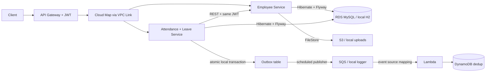

# 03 — Architecture: service boundaries and data flow

## Bounded contexts

Employee data and leave data change for different reasons. The Employee Service encapsulates identity-subject matching, org hierarchy and document metadata. Leave Service encapsulates leave rules, approval state, balance, audit and attendance. Notice no JPA entity holds a foreign-key relationship *across* services. `employeeId` is an external reference in the leave service.

## Communication types

**Synchronous (REST)** is appropriate when leave service must *immediately* check if an employee exists and whether the caller can access them. Requests carry the original Authorization bearer token to Employee Service, which validates and authorizes independently. This avoids trusting arbitrary internal X-Employee-ID headers.

**Asynchronous (SQS)** suits notification events because the leave approval must not depend on Lambda availability. Transactional outbox rows are committed along with decisions, then published later. Note the local publisher is not multi-instance-safe; see [06](06-DISTRIBUTED-SYSTEMS.md).

## Profiles and deployment topology

Local: two processes, two distinct in-memory H2 instances, local filesystem, explicit demo headers and logs. AWS: two ECS Fargate services, one RDS MySQL instance (shared *infrastructure*, separate owned tables), S3, Cognito, API Gateway Cloud Map private integrations, SQS and Lambda.

**Why one RDS schema in the tutorial?** RDS cost is frequently the dominant recurring cost. This intentionally reduces cost, but it is **not a strict database-per-service design** and the master user grants excessive permissions. A mature implementation gives each service separate schemas and credentials, ideally independent RDS lifecycle where justified. This is not a cross-service foreign-key architecture, but also not full storage isolation.

## AWS network topology

- VPC `10.52.0.0/16` across two Availability Zones.
- Two public subnets: ECS tasks receive a public IPv4 for AWS API/ECR/RDS-init-related outbound access; task security group allows inbound only from VPC Link and same task group for internal requests.
- Two private subnets: RDS is not publicly accessible, allows port 3306 only from ECS task security group.
- API Gateway VPC Link uses ENIs in the VPC and Cloud Map SRV records; service-to-service DNS uses A records. **No ALB, NAT Gateway, Route53 public zone** in the budget demo.
- Public IP assignment is an intentional trade-off. For production, use private tasks plus VPC endpoints/NAT and private networking, or an appropriate LB as needed.

## What is deliberately not modeled?

Payroll, HRIS integrations, complicated leave accrual or public holidays, resource booking, workflow engines, object-based authorization at a central policy decision point, OpenTelemetry collector, auto scaling, WAF, Secrets Manager rotation, full data encryption policies, Multi-AZ HA and database backups. These can be later exercises.
