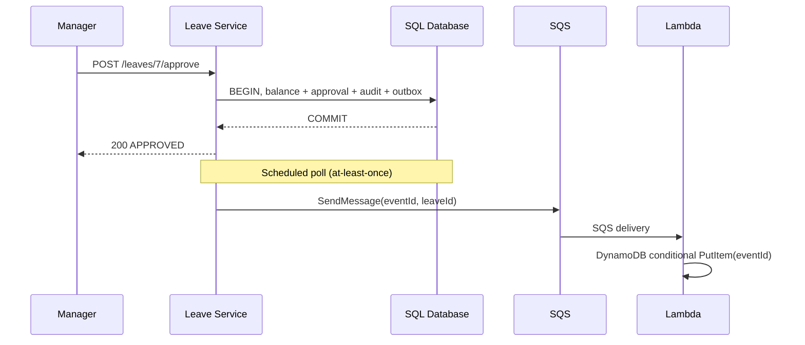

# 06 — Distributed systems: failure modes, event delivery and concurrency

## Why REST for employee lookup?

Leave Service needs an immediate answer about the employee and their manager; it does not read Employee Service's tables. RestClient sends a GET with a 2s connect and 3s read timeout. A Resilience4j circuit breaker opens when enough recent calls fail, preventing repeated waits on an unhealthy dependency. **No blind retry for POST approval**: retrying mutating commands without idempotency keys can duplicate changes.

## Approving leave (local atomic transaction)

Inside one `@Transactional` method: validate pending state, load employee/manager context, decrease balance, update request, insert audit row and write outbox event. **All local database writes either commit together or roll back together.** `@Version` on LeaveBalance and LeaveRequest helps detect conflicting transactions.

Example: both managers simultaneously approve the same request. Optimistic locking ensures at most one successful commit; the loser receives a conflict/transaction error and should re-fetch the latest state.

**Caveat:** concurrent first-time balance-row creation and concurrent overlapping leave submissions are not perfectly serialized. A production implementation adds unique active intervals or allocation locks/serializable transaction policies as appropriate and maps optimistic lock exceptions to HTTP 409 consistently. The demo is educational, not a guarantee of all concurrent edge cases.

## The dual-write problem

Wrong: transaction commits leave approval, then directly sends SQS. If the process crashes between the two, no event is delivered. Equally wrong: publish first, then DB transaction fails. Instead write `outbox_events` in the same transaction, then publish pending rows later.

## At-least-once + idempotency

SQS Standard queues can deliver messages at least once, occasionally more than once and out of order. The Lambda example uses `eventId` as the DynamoDB hash key with `attribute_not_exists(eventId)` conditional write. Already-seen events are acknowledged without duplicate log processing. Lambda returns `batchItemFailures` for failed SQS records so only failed records retry. After three failed deliveries messages can move to the DLQ.

### Important non-production edge cases

- The scheduler's `findTop20...` has **no database row claims**; with two Leave Service replicas, both may publish the same event. Lambda deduplication handles duplicate processing for the current log-only handler. For scaling: claim rows atomically using `SKIP LOCKED`, heartbeat locks, or a CDC-based outbox relay.
- The Lambda marks an event processed **before** any external email; if you add SES and it fails afterward, event will be dropped as processed. Production email requires a durable delivery state and retryable state transitions, **not** merely this conditional put.
- Event ordering is not assured by a standard SQS queue. Use FIFO with message groups if your business process requires ordered events.
- The demo exposes simple calendar-day leave rules and has no working-day/holiday calculation.

## Suggested chaos experiments

1. Stop employee-service; call the leave request API. Observe 502 / circuit breaker behavior.
2. Stop leave-service after approval while event is pending, restart; outbox rows persist **in AWS MySQL**, but local H2 memory resets on restart.
3. Kill Lambda permission to DynamoDB, examine CloudWatch retries and SQS DLQ, then restore.
4. Concurrently call approve twice; observe one update only.
