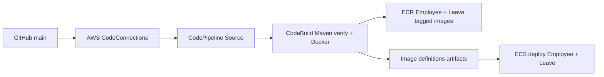

# 10 — AWS CodePipeline + CodeBuild + GitHub + ECS

## Pipeline design



**Manual first deployment:** build and push `v1` images, then Terraform create ECS services. **Optional automated deployments:** use `enable_pipeline=true` after pushing the code to GitHub and after manually bootstrapping the ECR services.

## Step 1 — Publish the repo safely

```bash
git init
git add .
git status
# Check no password, .tfstate, terraform.tfvars, .env, document uploads or credentials!
git commit -m "Initial workforce microservices portfolio"
# Create an empty GitHub repository, then add remote and push:
git branch -M main
git remote add origin https://github.com/YOUR_ACCOUNT/workforce-management-system.git
git push -u origin main
```

Do **not** blindly push without reviewing `git status` and secret-scanning for personal data.

## Step 2 — Turn on CodePipeline in Terraform

Edit `infrastructure/terraform/terraform.tfvars`:

```hcl
enable_pipeline = true
github_owner = "YOUR_GITHUB_ACCOUNT"
github_repo = "workforce-management-system"
github_branch = "main"
```

Run `terraform -chdir=infrastructure/terraform apply`. Terraform creates a CodeConnections GitHub connection in PENDING state. In AWS Console → Developer Tools → **Connections**, complete the GitHub authorization/installation; the connection must show **AVAILABLE** before pipeline source stages can run.

## Step 3 — What `buildspec.yml` does

1. CodeBuild starts a standard Linux image with Java 21 and Docker-in-Docker capability.
2. `mvn -B -ntp clean verify` runs the Java tests.
3. Logs in to ECR using short-lived IAM credentials.
4. Builds two container images from their `Dockerfile`s.
5. Tags each with the Git commit hash, pushes to ECR.
6. Writes `employee-imagedefinitions.json` and `leave-imagedefinitions.json` as the CodePipeline build artifact.
7. Two ECS Deploy actions update the matching ECS services.

**Why two ECS deploy actions?** Each ECS service is independently deployed and has its own task definition/container name. A single container update should not require a simultaneous deployment of all services in a mature project; this simple full-build pipeline teaches the mechanism first.

## Step 4 — Verify

Push a harmless documentation change to `main`; check Source → Build → Deploy pipeline execution and the ECS service events. For Java changes, verify new task revisions, CloudWatch logs and endpoints.

## Failures and troubleshooting

- Connection PENDING: finish GitHub handshake.
- Build failed while downloading Maven dependencies: confirm CodeBuild outbound network and Maven Central availability.
- Docker daemon unavailable: CodeBuild environment requires `privileged_mode=true`.
- ECR push denied: check CodeBuild role, repository names and AWS region.
- ECS deployment failed: inspect task events, service discovery/health, DB migrations, IAM and image architecture.
- Pipeline costs: CodeBuild usage, CodePipeline V2 usage, artifact bucket, ECR storage and repeated builds can consume credits.

## Senior-level next steps

Add approval before production, isolated environments, smaller per-service pipelines (build only changed service), dependency/cache optimization, SAST/security scans, SBOM generation, image signing, one-time migrations, blue/green/canary deployment, staged traffic rollback, OIDC-based GitHub Actions as an alternative. The current pipeline is an educational V1-style source→build→deploy workflow, not a full enterprise release governance system.
